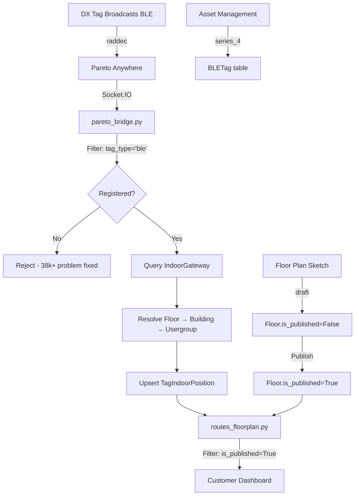

# Floor Plan Workflow v2 - Series 4 DX-Smart Tags

## Overview

This update introduces a complete workflow for managing BLE indoor tracking with DX-Smart CP27/CP28/CP29 tags. The workflow separates **draft floor plans** (Management section) from **live tracking** (Tracking section).

---

## 🎯 Workflow Summary

### 1. **Asset Management** → Add Series 4 Tags (DX-Smart BLE)
Register your DX-Smart tags as `series_4` assets

### 2. **Management > Floor Plan Sketch** → Design & Configure  
Create buildings, floors, rooms, and place gateways (draft mode)

### 3. **Publish** → Lock Floor Plan
Click "Publish" to make it available for live tracking

### 4. **Tracking > Floor Plan** → Monitor Assets
View real-time positions with dropdown floor selector

---

## 📋 Database Changes

### Migration: `054_add_floor_publish_workflow.py`

**New Fields:**

```sql
-- floors table
ALTER TABLE floors ADD COLUMN is_published BOOLEAN DEFAULT FALSE;
ALTER TABLE floors ADD COLUMN published_at TIMESTAMP WITH TIME ZONE;
ALTER TABLE floors ADD COLUMN published_by UUID REFERENCES portal_users(id);

-- indoor_gateways table
ALTER TABLE indoor_gateways ADD COLUMN room_id UUID REFERENCES rooms(id);
```

**Run Migration:**
```bash
cd gps-tracker/backend
docker compose exec backend alembic upgrade head
```

---

## 🔧 Model Updates

### `Floor` Model
```python
class Floor(Base):
    # ... existing fields ...
    is_published = Column(Boolean, nullable=False, default=False)
    published_at = Column(DateTime(timezone=True), nullable=True)
    published_by = get_uuid_fk_nullable("portal_users.id")
```

### `IndoorGateway` Model
```python
class IndoorGateway(Base):
    # ... existing fields ...
    room_id = get_uuid_fk_nullable("rooms.id")  # Link gateway to room
    room = relationship("Room", foreign_keys=[room_id])
```

### `BLETag` Model
```python
tag_type = Column(String(50), nullable=True, default='series1')  
# 'series1' | 'series2' | 'series_3' | 'series_4' (DX-Smart BLE) | 'scope' | 'ble'
```

---

## 🌐 New API Endpoints

### Publish Floor Plan
```http
POST /api/portal/buildings/{building_id}/floors/{floor_id}/publish
Authorization: Bearer <jwt>

Response: 200 OK
{
  "id": "uuid",
  "is_published": true,
  "published_at": "2026-06-24T12:00:00Z",
  "published_by": "user-uuid"
}

Error: 400 Bad Request
{
  "detail": "Cannot publish: At least 1 gateway required"
}
```

**Requirements:**
- At least 1 gateway registered
- Group admin permission
- Floor plan image (optional but recommended)

### Unpublish Floor Plan
```http
POST /api/portal/buildings/{building_id}/floors/{floor_id}/unpublish
Authorization: Bearer <jwt>

Response: 200 OK
{
  "id": "uuid",
  "is_published": false
}
```

### Update Gateway (Enhanced)
```http
PUT /api/portal/gateways/{gateway_id}
Authorization: Bearer <jwt>
Content-Type: application/json

{
  "room_id": "uuid-or-null",
  "x": 150.0,
  "y": 200.0,
  "label": "Gateway 1"
}
```

**New Field:** `room_id` - Links gateway to a specific room

---

## 📱 Customer Dashboard Workflow

### Step 1: Register Series 4 Tags (Asset Management)

1. Navigate to **Asset Management**
2. Click **Add Asset**
3. Fill in form:
   - **IMEI**: Enter DX tag MAC address (e.g., `aa:bb:cc:dd:ee:ff` or `aabbccddeeff`)
   - **Tag Type**: Select `Series 4` (DX-Smart Indoor BLE)
   - **Device Name**: `Living Room Tag`, `Warehouse Tag 1`, etc.
   - **Device Model**: `CP27`, `CP28`, or `CP29`
4. Click **Save**

**Backend Processing:**
- Normalizes MAC address: lowercase, no colons → `aabbccddeeff`
- Sets `tag_type='ble'` (series_4 is an alias)
- Sets `is_active=True`
- Enables indoor tracking automatically

---

### Step 2: Design Floor Plan (Management > Floor Plan Sketch)

#### 2.1 Create Building & Floor

1. Navigate to **Management** > **Floor Plan Sketch**
2. Create Building:
   - **Name**: `Main Building`, `Warehouse A`, etc.
   - **MQTT URL**: (optional, for external integrations)
3. Add Floor:
   - **Label**: `G` (Ground), `1F` (First Floor), `2F`, etc.
   - **Floor Order**: 0, 1, 2, 3...
   - **Upload Floor Plan Image**: PNG/JPG of building layout

#### 2.2 Define Rooms (Optional)

1. Click **Add Room**
2. Draw rectangle on floor plan:
   - **Name**: `Living Room`, `Office`, `Warehouse Zone A`, etc.
   - **X, Y, W, H**: Position and dimensions
3. Repeat for all rooms

#### 2.3 Register Gateways

1. Flash ESP32S3 XIAO with gateway firmware
2. Power on gateway - note its MAC address from Serial Monitor
3. In Floor Plan Sketch, click **Add Gateway**:
   - **Receiver ID**: ESP32 MAC (e.g., `aa11bb22cc33`)
   - **Label**: `Gateway 1`, `Main Entrance`, etc.
   - **Room**: Select room (optional)
   - **Position (X, Y)**: Drag on floor plan or enter coordinates
4. Click **Save**

**Verification:**
- Check `/api/portal/floorplan/gateways/unregistered`
- Gateway MAC should disappear from unregistered list

---

### Step 3: Publish Floor Plan

1. Review your floor plan:
   - ✅ At least 1 gateway registered
   - ✅ Floor plan image uploaded (optional)
   - ✅ Rooms defined (optional)
2. Click **Publish** button
3. Confirmation dialog:
   ```
   Publish "Ground Floor"?
   
   This will make the floor plan available for live tracking.
   You can unpublish later to make changes.
   
   [Cancel] [Publish]
   ```
4. Floor plan is now locked and visible in **Tracking**

**What Happens:**
- `is_published` → `true`
- `published_at` → current timestamp
- `published_by` → your user ID
- Floor appears in Tracking > Floor Plan dropdown

---

### Step 4: Monitor Assets (Tracking > Floor Plan)

1. Navigate to **Tracking** > **Floor Plan**
2. Select floor from dropdown:
   ```
   Floor Plan
   ┌─────────────────────────────┐
   │ Ground Floor (Main Building)│ ← Dropdown
   └─────────────────────────────┘
   ```
3. View real-time positions:
   - 🚛 Vehicle tags
   - 📦 Equipment tags
   - 🧑 Personnel badges
4. Click tag for details:
   - Battery level
   - RSSI signal strength
   - Last seen timestamp
   - Zone/Room name

**Auto-refresh:** 2.5 second cache, live updates via Pareto Anywhere

---

## 🔐 Permissions

| Action | Required Permission |
|--------|---------------------|
| View published floor plans (Tracking) | Any portal user |
| Create/edit floor plans (Management) | Group admin |
| Publish/unpublish floor plans | Group admin |
| Register gateways | Group admin |
| Add Series 4 tags (Asset Management) | Any portal user with asset-mgmt feature |

---

## 🧪 Testing Checklist

### Backend Testing

```bash
# Run migration
docker compose exec backend alembic upgrade head

# Verify schema
docker compose exec backend python -c "
from app.database import SessionLocal
from app.models import Floor, IndoorGateway
from sqlalchemy import inspect
db = SessionLocal()
floor_cols = [c.name for c in inspect(Floor).columns]
gw_cols = [c.name for c in inspect(IndoorGateway).columns]
print('Floor columns:', floor_cols)
print('Gateway columns:', gw_cols)
assert 'is_published' in floor_cols
assert 'room_id' in gw_cols
print('✅ Schema updated successfully')
"

# Test publish workflow
curl -X POST http://localhost:8000/api/portal/buildings/{building_id}/floors/{floor_id}/publish \
  -H "Authorization: Bearer YOUR_JWT" \
  -H "Content-Type: application/json"

# Verify only published floors appear in tracking
curl http://localhost:8000/api/portal/floorplan/floors \
  -H "Authorization: Bearer YOUR_JWT"
```

### Frontend Testing

1. ✅ Asset Management shows "Series 4" option in tag type dropdown
2. ✅ Floor Plan Sketch shows Publish button for draft floors
3. ✅ Published floors show "Published" badge + Unpublish button
4. ✅ Gateway edit form includes Room dropdown
5. ✅ Tracking > Floor Plan dropdown only shows published floors
6. ✅ Draft floors invisible in Tracking section

---

## 🚀 Deployment Steps

### 1. Commit Changes

```bash
cd /Users/carl/Documents/MobileCode/Pinplot

git add gps-tracker/backend/alembic/versions/054_add_floor_publish_workflow.py
git add gps-tracker/backend/app/models.py
git add gps-tracker/backend/app/routes_portal.py
git add gps-tracker/backend/app/routes_floorplan.py

git commit -m "feat(floor-plan): add publish workflow and Series 4 DX-Smart tags

- Add publish/unpublish endpoints for floor plans
- Separate draft (Management) vs live (Tracking) floor plans
- Link gateways to rooms for better organization
- Add series_4 tag type for DX-Smart CP27/CP28/CP29 indoor BLE tags
- Migration 054: is_published, published_at, published_by, gateway.room_id"

git push origin main
```

### 2. Run Migration on Server

```bash
# SSH to server
ssh root@pinplot.me

# Navigate to project
cd ~/pinplot/gps-tracker

# Run migration
docker compose exec backend alembic upgrade head

# Verify
docker compose exec backend python -c "
from app.database import SessionLocal
from app.models import Floor
db = SessionLocal()
f = db.query(Floor).first()
print('is_published' in dir(f))
"

# Restart backend to reload models
docker compose restart backend
```

### 3. Verify Deployment

```bash
# Check API health
curl https://pinplot.me/api/health

# Test new endpoints
curl https://pinplot.me/api/portal/floorplan/floors \
  -H "Authorization: Bearer YOUR_JWT"
```

---

## 📊 Architecture Flow



---

## 🔄 Migration from Old Workflow

If you have existing floor plans:

```python
# Mark all existing floors as published (one-time migration)
docker compose exec backend python -c "
from app.database import SessionLocal
from app.models import Floor
db = SessionLocal()
floors = db.query(Floor).filter(Floor.is_published == False).all()
for f in floors:
    f.is_published = True
print(f'Published {len(floors)} existing floors')
db.commit()
"
```

---

## 🐛 Troubleshooting

### Floor plan not showing in Tracking

**Cause:** `is_published=False`  
**Fix:** Go to Management > Floor Plan Sketch → Click Publish

### Gateway not receiving tags

**Cause:** Gateway not registered or tag not series_4  
**Fix:** 
1. Check `/api/portal/floorplan/gateways/unregistered`
2. Verify tag has `tag_type='ble'` in database
3. Check pareto_bridge logs: `docker compose logs backend | grep pareto_bridge`

### Cannot publish: "At least 1 gateway required"

**Cause:** No gateways registered for this floor  
**Fix:** Add at least 1 gateway via Floor Plan Sketch

### Tag not appearing on floor plan

**Checklist:**
1. ✅ Tag registered as `series_4` in Asset Management
2. ✅ Tag MAC matches BLE advertisement (check Serial Monitor)
3. ✅ Gateway registered and linked to floor
4. ✅ Floor is published
5. ✅ Tag is broadcasting (check RSSI in logs)
6. ✅ Pareto Anywhere is running: `docker compose ps pareto-anywhere`

---

## 📚 Related Files

- **Migration**: `gps-tracker/backend/alembic/versions/054_add_floor_publish_workflow.py`
- **Models**: `gps-tracker/backend/app/models.py`
- **Portal API**: `gps-tracker/backend/app/routes_portal.py`
- **Tracking API**: `gps-tracker/backend/app/routes_floorplan.py`
- **Pareto Bridge**: `gps-tracker/backend/app/services/pareto_bridge.py`
- **Spec**: `features_dev/pinplot-mvp-floorplan v2.md`

---

## 🎉 Summary

### What Changed

| Component | Before | After |
|-----------|--------|-------|
| **Tag Registration** | Manual MAC entry | Series 4 option in Asset Management |
| **Floor Plans** | All visible in Tracking | Draft (Management) vs Published (Tracking) |
| **Gateways** | Position only | Position + Room assignment |
| **Tracking View** | Single floor hardcoded | Dropdown with published floors |
| **Workflow** | Ad-hoc | Clear 4-step process |

### Benefits

✅ **Clearer UX** - Separate draft/design from live tracking  
✅ **Better Organization** - Room-based gateway grouping  
✅ **Scalability** - Support multiple buildings/floors with dropdown  
✅ **Safety** - Can't accidentally show incomplete floor plans to users  
✅ **Flexibility** - Unpublish to edit, republish when ready

---

**Need Help?** Check the spec: `features_dev/pinplot-mvp-floorplan v2.md` §6-7
